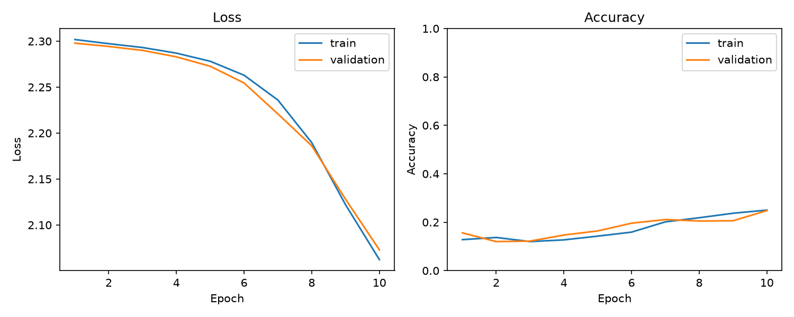

# CV Learning Lab

컴퓨터 비전의 개념, 모델 구현, 학습·추론과 비교 실험을 기록하는 학습 저장소입니다.
학습한 내용을 챕터별·모델별·기술별로 정리하고 계속 확장합니다.

## 개발 환경

- Ubuntu / WSL
- VS Code / WSL 연결
- Python / 프로젝트별 가상환경
- PyTorch / torchvision / matplotlib
- CPU 실행

<details>
<summary>챕터별 정리</summary>

<details>
<summary>챕터 1 — 텐서와 작은 CNN 기초</summary>

### 학습 내용

- 이미지 배치의 `[N, C, H, W]` 구조
- 인덱싱·슬라이싱의 차원 유지 차이
- 원소 수를 유지하는 reshape
- 합성곱·ReLU·MaxPooling
- Flatten·Linear를 통한 클래스별 점수 출력
- nn.Module·forward·모듈 import
- CIFAR-10 전처리·DataLoader

### 모델 흐름

| 단계 | 출력 shape |
|---|---|
| 입력 | `[4, 3, 32, 32]` |
| Conv → ReLU → Pool | `[4, 8, 16, 16]` |
| Conv → ReLU → Pool | `[4, 16, 8, 8]` |
| Flatten | `[4, 1024]` |
| Linear | `[4, 10]` |

### 코드

- [텐서](chapters/01_cnn_basics/tensor_basics.py)
- [합성곱](chapters/01_cnn_basics/conv_basics.py)
- [모델](chapters/01_cnn_basics/model.py)
- [데이터 로딩](chapters/01_cnn_basics/data_basics.py)

</details>

<details>
<summary>챕터 2 — 학습·검증과 지표 시각화</summary>

### 학습 흐름

```python
optimizer.zero_grad()
logits = model(images)
loss = criterion(logits, labels)
loss.backward()
optimizer.step()
```

- zero_grad: 이전 기울기 초기화
- forward: 현재 가중치로 출력 계산
- loss: 출력과 정답 비교
- backward: 기울기 계산
- step: 파라미터 업데이트

모델과 optimizer는 epoch 반복문 밖에서 생성하여 학습 상태를 유지한다.

### 학습과 검증

- train()은 학습 모드 설정이며, 학습 실행 자체가 아니다.
- 매 epoch 학습 후 검증셋을 평가한다.
- 검증에서는 eval()과 no_grad()를 사용한다.
- 검증에서는 역전파와 가중치 업데이트를 하지 않는다.

### 실습 설정

| 항목 | 설정 |
|---|---|
| 데이터 | CIFAR-10 |
| 학습 / 검증 | 공식 학습셋에서 겹치지 않게 선택한 2,000장 / 1,000장 |
| 입력 | RGB 32×32, ToTensor |
| 채널 | 8·16 |
| 배치 크기 | 32 |
| 학습 횟수 | 10 epoch |
| 손실 함수 | CrossEntropyLoss |
| Optimizer | SGD, lr=0.01 |
| 시드 | 42 |
| 장치 | CPU |

### 지표 집계

배치 평균 loss에 실제 배치 크기를 곱해 누적한 뒤,
전체 이미지 수로 나누어 평균 loss를 계산한다.
accuracy는 정답 수를 전체 이미지 수로 나눈다.

학습 지표는 업데이트 도중 배치별 결과를 누적한 값이고,
검증 지표는 해당 epoch 종료 후 모델로 계산한 값이다.

### 확인한 내용

학습·검증을 실행하여 loss 감소와 accuracy 상승을 확인했다.
지표를 CSV와 그래프로 저장했다.
이번 실습의 목적은 학습·검증 흐름과 시각화 구현이다.

### 코드와 결과

- [한 배치 업데이트](chapters/01_cnn_basics/train_step.py)
- [학습·검증·시각화](chapters/01_cnn_basics/train.py)
- [지표 CSV](results/01_cnn_basics/history.csv)



</details>

<details>
<summary>챕터 3 — 모델 저장·복원과 외부 이미지 추론</summary>

### 저장과 복원

state_dict와 클래스·입력 설정을 함께 저장한다.

```python
torch.save(checkpoint, checkpoint_path)

checkpoint = torch.load(
    checkpoint_path,
    map_location="cpu",
    weights_only=True,
)

model = SmallCNN()
model.load_state_dict(checkpoint["model_state_dict"])
model.eval()
```

- state_dict에는 가중치·편향 등 모델 상태가 들어간다.
- 모델 구조의 Python 코드 자체를 저장하는 것은 아니다.
- 복원할 때 호환되는 구조를 생성한 뒤 저장된 상태를 적용한다.
- 현재는 마지막 epoch 상태를 저장하며 optimizer 상태는 포함하지 않는다.
- 전처리 이름을 문자열로 기록해도 자동 실행되지는 않는다.

### 외부 이미지 적용

```text
이미지 읽기 → RGB 변환 → 32×32 Resize → ToTensor
→ 배치 차원 추가 → 모델 추론 → 클래스·점수 출력
```

```python
image_tensor = transform(image).unsqueeze(0)

with torch.no_grad():
    logits = model(image_tensor)

probabilities = torch.softmax(logits, dim=1)
class_index = probabilities.argmax(dim=1).item()
class_name = checkpoint["classes"][class_index]
```

### 확인한 내용

별도 predict.py에서 모델을 복원하고 고양이 사진을 입력했다.

- 입력 shape: `[1, 3, 32, 32]`
- 예측 클래스: cat
- Softmax 점수: 13.02%

이번 실습의 목적은 저장한 모델을 외부 이미지에 적용하는 흐름의 구현이다.
Softmax 점수는 실제 정답 확률을 보장하지 않는다.

### 실행

프로젝트 루트에서 실행한다.
이미지 경로는 predict.py에서 지정한다.

```bash
source .venv/bin/activate

# 가중치가 없으면 먼저 학습·저장
python chapters/01_cnn_basics/train.py

# 저장된 가중치로 추론
python chapters/01_cnn_basics/predict.py
```

가중치와 개인 이미지는 Git에서 제외한다.

</details>

<details>
<summary>챕터 4 — 채널 수에 따른 통제된 비교 실험</summary>

### 질문

SmallCNN의 특징 채널을 8·16에서 4·8로 줄이면
파라미터 수·학습 결과·CPU 추론시간이 어떻게 달라지는가?

### 비교 조건

| 항목 | 설정 |
|---|---|
| 비교 구성 | 채널 8·16 / 채널 4·8 |
| 데이터 | 동일한 CIFAR-10 학습 2,000장·검증 1,000장 |
| 입력 | RGB 32×32, ToTensor |
| 배치 | 32, 두 모델의 학습 배치 순서 동일 |
| 학습 | 각각 새 모델로 100 epoch |
| Optimizer | SGD, lr=0.01 |
| 시드 | 42 |
| 조기 종료 | 사용하지 않음 |
| 저장 모델 | 100 epoch의 마지막 상태 |

채널 변경에 맞춰 다음 합성곱의 입력 채널과
Linear의 입력 특징 수도 변경했다.

### 100 epoch 결과

| 항목 | 기준 8·16 | 축소 4·8 |
|---|---:|---:|
| 파라미터 수 | 11,642 | 5,538 |
| 최종 학습 loss | 0.8822 | 1.2034 |
| 최종 검증 loss | 1.8076 | 1.8000 |
| 최종 학습 accuracy | 70.10% | 58.65% |
| 최종 검증 accuracy | 42.80% | 40.60% |
| 학습·검증 총시간 | 55.02초 | 40.90초 |

초기 10 epoch 실행에서는 검증 accuracy가 각각 26.7%, 15.6%였다.
100 epoch에서는 차이가 11.1%p에서 2.2%p로 줄었다.
짧은 학습 결과만으로 구조의 우열을 단정하기 어렵다는 점을 확인했다.
현재 결과 폴더에는 100 epoch 결과를 저장했다.

### CPU 추론시간 측정

| 조건 | 설정 |
|---|---|
| 입력 | 동일한 `[1, 3, 32, 32]` 텐서 |
| 장치·자료형 | CPU·float32 |
| CPU 연산 스레드 | 1개 |
| 실행 모드 | eval·no_grad |
| 사전 실행 | 모델마다 30회 |
| 측정 | 100회 호출을 1묶음으로 10묶음 |
| 순서 | 묶음마다 모델 측정 순서 교대 |
| 포함 범위 | model(images) 순전파 |
| 제외 범위 | 모델 로딩·파일 읽기·전처리·Softmax |

| 항목 | 기준 8·16 | 축소 4·8 |
|---|---:|---:|
| 호출당 평균 시간의 중앙값 | 0.1150 ms | 0.0807 ms |
| 묶음별 평균 시간 범위 | 0.1025~0.1226 ms | 0.0759~0.0894 ms |

중앙값은 개별 호출 시간이 아니라,
각 묶음의 호출당 평균 시간 10개에서 구한 값이다.

### 해석

이번 조건에서 축소 모델은 기준 모델보다:

- 파라미터 수가 약 52.4% 감소했다.
- 학습·검증 시간이 약 25.7% 감소했다.
- CPU 순전파 시간이 약 29.8% 감소했다.
- 최종 검증 accuracy는 2.2%p 낮았다.

채널 축소에 따른 모델 크기·계산 비용과 분류 결과의 절충을 확인했다.
파라미터 수 감소가 실행시간 감소에 그대로 비례하지는 않았다.

후반에는 학습 loss 감소와 달리 검증 loss가 최저점보다 높아지는
과적합 징후도 관찰했다. 최저 검증 loss 시점은 기준 모델 74 epoch,
축소 모델 90 epoch였으며 해당 가중치를 별도로 저장하지는 않았다.

### 한계와 후속 후보

- 단일 seed·분할의 학습용 실험이다.
- 동일한 seed가 다른 구조의 초기 가중치를 같게 만들지는 않는다.
- 결과를 다른 데이터·장치·학습 설정으로 일반화하지 않는다.
- 측정한 순전파 시간은 실제 서비스의 전체 응답시간이 아니다.
- RGB·흑백·개별 색상 채널 비교는 아직 수행하지 않았다.

### 코드와 결과

- [채널 설정이 가능한 모델](chapters/01_cnn_basics/model.py)
- [비교 학습](chapters/01_cnn_basics/compare_channels.py)
- [추론시간 측정](chapters/01_cnn_basics/benchmark_channels.py)
- [학습 결과 요약](results/channel_comparison/summary.csv)
- [기준 모델 학습 기록](results/channel_comparison/channels_8_16_history.csv)
- [축소 모델 학습 기록](results/channel_comparison/channels_4_8_history.csv)
- [추론시간 기록](results/channel_comparison/inference_benchmark.csv)

</details>

</details>

<details>
<summary>모델별 정리</summary>

<details>
<summary>SmallCNN — 직접 구성한 이미지 분류 CNN</summary>

### 구조

```text
Conv(3→c1) → ReLU → MaxPool
→ Conv(c1→c2) → ReLU → MaxPool
→ Flatten → Linear(c2×8×8→10)
```

- 입력: RGB 32×32 이미지 배치
- 출력: 클래스별 logits 10개
- 합성곱: kernel=3, stride=1, padding=1
- Pooling: kernel=2, stride=2
- 채널 기본값: c1=8, c2=16

### shape

```text
[N, 3, 32, 32]
→ [N, c1, 16, 16]
→ [N, c2, 8, 8]
→ [N, c2×8×8]
→ [N, 10]
```

### 특징·제약

작은 구조로 층별 연산과 학습 흐름을 관찰하기 쉽다.
Linear의 입력 특징 수가 고정되어 있으므로 입력 크기나
공간 축소 구성을 바꿀 때 연결되는 shape를 확인해야 한다.

### 학습한 내용

- CIFAR-10 학습·검증과 곡선 생성
- 가중치 저장·복원과 외부 이미지 추론
- 채널 8·16과 4·8의 비교
- 파라미터 수와 CPU 순전파 시간 측정

### 클래스 순서

```text
airplane, automobile, bird, cat, deer,
dog, frog, horse, ship, truck
```

[모델 코드](chapters/01_cnn_basics/model.py)

</details>

</details>

<details>
<summary>기술별 정리</summary>

<details>
<summary>텐서·배치·shape</summary>

- 이미지 배치는 `[N, C, H, W]`이다.
- images[0]은 배치 차원을 제거하고 images[:1]은 유지한다.
- reshape는 원소 수를 유지하며 형태를 바꾼다.
- unsqueeze(0)은 맨 앞에 크기 1인 차원을 추가한다.
- 텐서 용도에 따라 각 축의 의미가 다르다.

</details>

<details>
<summary>합성곱·채널·가중치</summary>

Conv2d의 앞 두 인자는 입력 채널과 출력 채널이다.
배치 크기는 모델 생성 시 지정하지 않는다.

일반적인 groups=1 합성곱의 가중치 shape는
`[출력 채널, 입력 채널, 커널 높이, 커널 너비]`이다.

각 출력 필터는 입력 채널별 계산을 합하고 편향을 더해 특징맵을 만든다.
같은 필터를 배치의 모든 이미지에 적용한다.

- weight[0]: 첫 출력 필터 전체
- weight[0, 0]: 첫 출력 필터의 첫 입력 채널용 커널
- features[0]: Sequential의 첫 번째 층
- stride: 필터 이동 간격
- padding: 입력 가장자리 확장

특징 채널 축소와 RGB 입력 채널의 정보 제거는 다른 실험이다.

</details>

<details>
<summary>ReLU·Pooling·Flatten·Linear</summary>

- ReLU는 max(0, x)로 비선형성을 추가하고 shape를 유지한다.
- ReLU의 음수 구간에서는 기울기가 0이다.
- MaxPooling은 채널별 공간 크기를 줄이며 학습 파라미터가 없다.
- Pooling은 작은 특징과 위치 정보를 잃을 수 있다.
- Flatten은 배치를 유지하며 이미지별 특징을 펼친다.
- Linear는 펼쳐진 특징 수를 받아 클래스별 점수로 변환한다.
- Linear 자체는 채널·높이·너비를 구분하지 않는다.

</details>

<details>
<summary>Dataset·전처리·DataLoader</summary>

- Dataset은 이미지와 정답을 제공한다.
- CIFAR-10의 train=True는 공식 학습용 분할을 선택한다.
- Subset은 지정한 인덱스의 데이터만 사용한다.
- randperm은 정수 인덱스를 중복 없이 섞는다.
- ToTensor는 CIFAR-10 이미지를 `[C, H, W]`로 변환하고
  픽셀값을 0~255에서 0~1로 바꾼다.
- DataLoader는 데이터를 배치로 묶는다.
- num_workers=0은 현재 프로세스에서 데이터를 읽는다는 뜻이다.
- 마지막 배치는 설정한 배치 크기보다 작을 수 있다.
- transform은 전처리를 담은 변수명이다.
- torchvision.transforms와 신경망 구조 Transformer는 다른 개념이다.

</details>

<details>
<summary>logits·Softmax·CrossEntropyLoss</summary>

- logits는 클래스별 점수이며 확률이 아니다.
- argmax(dim=1)은 클래스 축에서 최대 점수의 위치를 반환한다.
- Softmax는 점수를 합이 1인 분포로 변환한다.
- Softmax 점수는 실제 정답 확률을 보장하지 않는다.
- CrossEntropyLoss 앞에 별도 Softmax를 붙이지 않는다.
- 클래스 번호 형태의 정답은 이미지마다 하나이며 torch.long을 사용한다.

</details>

<details>
<summary>역전파·Optimizer·학습 설정</summary>

- zero_grad: 이전 기울기 초기화
- backward: 기울기를 계산하여 grad에 누적
- step: Optimizer 규칙에 따라 파라미터 수정
- model.parameters(): 등록된 파라미터 제공
- 기본 SGD: `새 가중치 = 현재 가중치 - 학습률 × 기울기`
- detach().clone(): 기울기 추적에서 분리한 별도 복사본 생성

가중치·편향은 학습 파라미터이다.
학습률·배치·학습 횟수와 모델 구조·전처리는 사람이 선택하거나 탐색한다.
가중치를 직접 수정할 수도 있지만 보통 학습 알고리즘으로 조정한다.

</details>

<details>
<summary>학습·검증과 지표 집계</summary>

- train()은 학습 모드 설정이며 학습 실행 자체가 아니다.
- eval()은 평가 모드 설정이며 기울기 추적을 중지하지 않는다.
- no_grad()는 기울기 추적을 중지하며 평가 모드를 설정하지 않는다.
- 검증에서는 역전파와 파라미터 업데이트를 하지 않는다.
- 전체 평균 loss는 배치 평균에 실제 배치 크기를 곱해 누적한 뒤
  전체 이미지 수로 나눈다.
- accuracy는 정답 수를 전체 이미지 수로 나눈다.
- loss와 accuracy는 반영하는 정보가 달라 순위가 다를 수 있다.

</details>

<details>
<summary>통제된 비교·난수 시드·탐색</summary>

- 질문을 정하고 변경 조건과 고정 조건을 명시한다.
- 데이터 분할과 배치 순서를 맞추어 비교한다.
- 모델마다 새 모델과 optimizer를 생성한다.
- 같은 seed가 서로 다른 모델의 초기 가중치를 같게 만들지는 않는다.
- 짧은 학습 결과만으로 모델의 최종 우열을 단정하지 않는다.
- 단일 seed 결과는 초기화에 따른 변동을 충분히 보여주지 못한다.

설정 탐색에는 grid search, random search, Bayesian optimization 등이 있다.
자동 탐색에서도 목표 지표·탐색 범위·자원 예산은 정해야 한다.
현재는 최적값 탐색보다 변경의 영향을 이해하는 학습용 실험을 진행했다.

</details>

<details>
<summary>CPU 추론시간 측정</summary>

- 모델 로딩과 입력 준비를 측정에서 분리한다.
- warm-up 후 반복 실행한다.
- 장치·입력·batch size·자료형·스레드 수를 기록한다.
- 짧은 호출은 여러 번 실행한 시간을 나누어 측정한다.
- 묶음별 평균의 중앙값과 개별 요청 시간의 중앙값을 구분한다.
- 파라미터 감소율과 실제 시간 감소율은 다를 수 있다.
- 순전파 시간과 서비스 전체 응답시간을 구분한다.

</details>

<details>
<summary>CSV·matplotlib</summary>

- epoch별 지표를 딕셔너리로 만들어 리스트에 누적한다.
- csv.DictWriter로 열 이름과 지표를 저장한다.
- plt.subplots로 그림과 그래프 영역을 생성한다.
- plot으로 곡선, legend로 범례를 표시한다.
- Agg 백엔드로 창 없이 이미지를 저장한다.
- savefig 후 plt.close로 그림 객체를 정리한다.

</details>

<details>
<summary>체크포인트·저장·복원</summary>

- 체크포인트는 특정 시점의 모델 상태를 저장한 것이다.
- 폴더명 checkpoints 자체에 특별한 기능은 없다.
- state_dict는 파라미터와 버퍼 등의 상태를 제공한다.
- torch.save로 저장하고 torch.load로 읽는다.
- load_state_dict로 모델에 상태를 적용한다.
- .pt는 바이너리 파일이며 내부 저장 구조는 파일마다 다를 수 있다.
- 모델 구조와 저장된 가중치의 이름·shape가 호환되어야 한다.
- 현재 파일에는 optimizer 상태가 없어 전체 학습 재개 상태를 저장한 것은 아니다.

</details>

<details>
<summary>Python 모듈·직접 실행</summary>

- model.py는 모듈이고 SmallCNN은 그 안의 클래스이다.
- from model import SmallCNN으로 클래스 정의를 가져온다.
- Python은 일반적인 최상위 함수·클래스에 export가 필요 없다.
- SmallCNN()은 인스턴스를 생성하며 학습 가중치를 자동으로 읽지 않는다.
- 직접 실행한 파일의 __name__은 "__main__"이다.
- 해당 조건문 아래 코드는 파일을 직접 실행할 때만 수행된다.

</details>

</details>