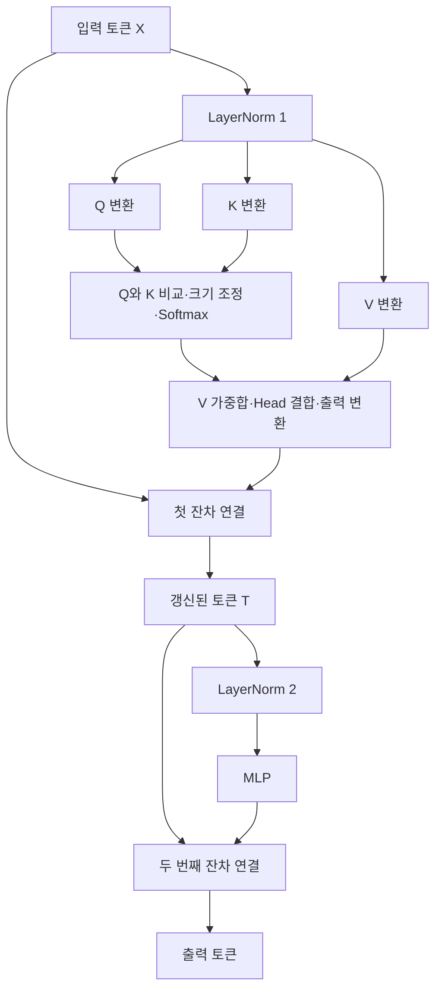
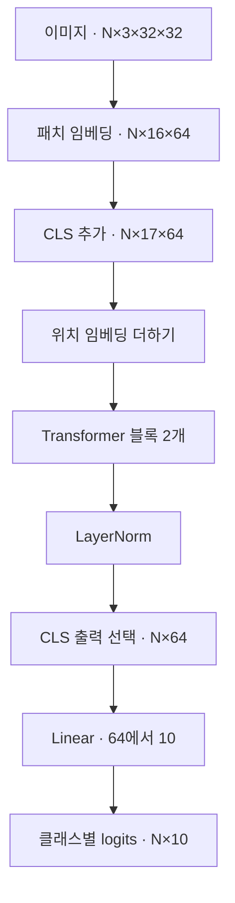
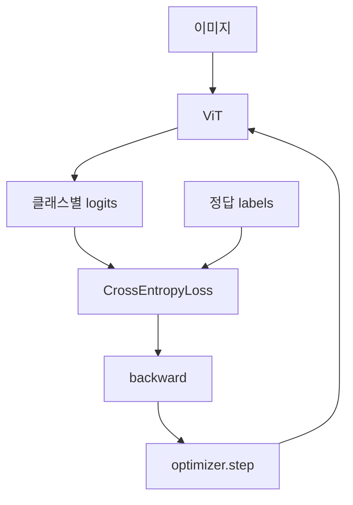
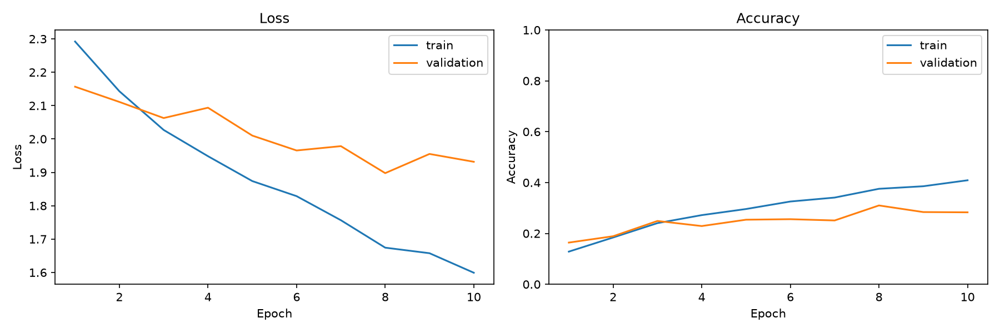
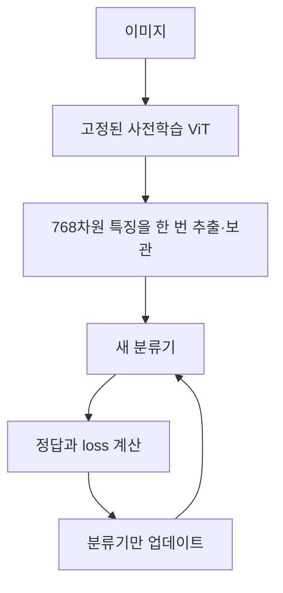
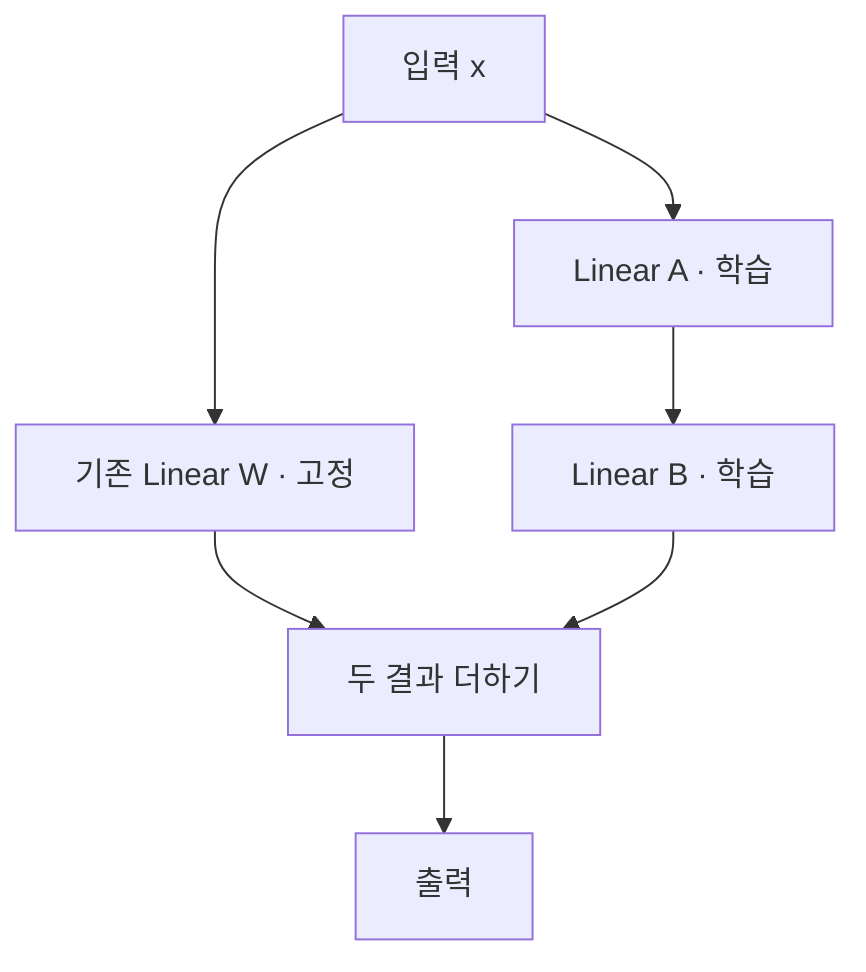
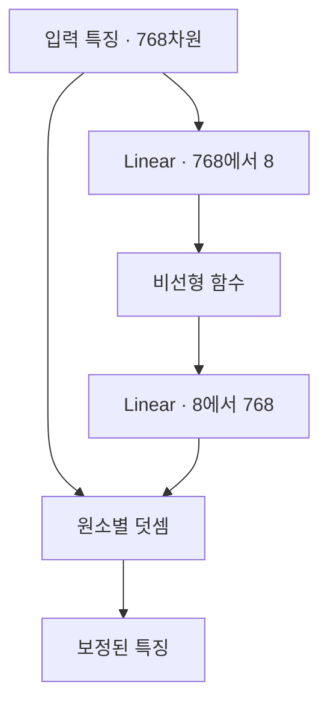
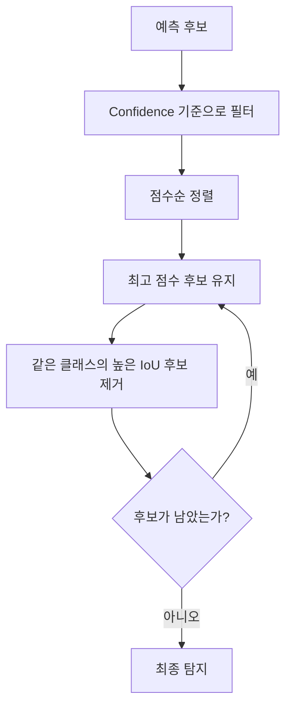
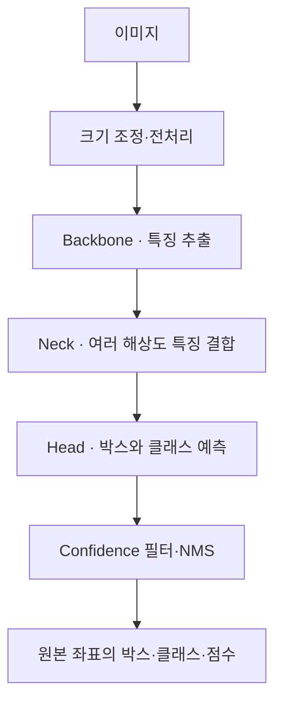
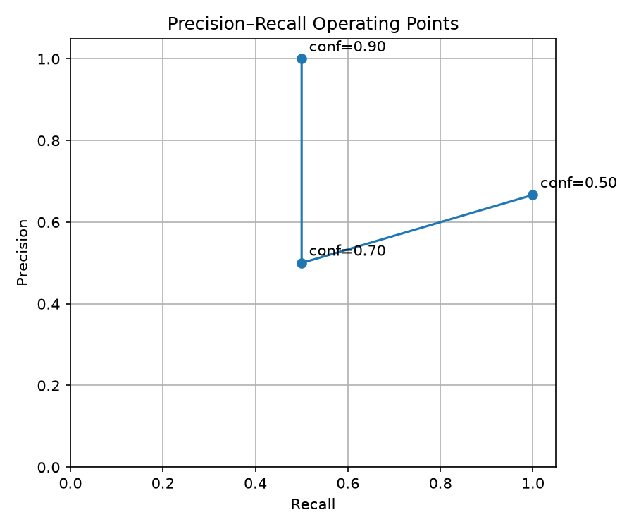

# CV Learning Lab

컴퓨터 비전의 개념, 모델 구조, 학습·추론과 비교 실험을 기록하는 학습 저장소입니다.
챕터별·모델별·기술별로 정리하며, 추가 학습에 따라 계속 확장합니다.

## 개발 환경

- Ubuntu / WSL
- VS Code / WSL 연결
- Python / 프로젝트별 가상환경
- PyTorch / torchvision / matplotlib
- CPU 실행

## 학습 진행

| 챕터 | 내용 | 상태 |
|---|---|---|
| 1 | 텐서와 작은 CNN 기초 | 완료 |
| 2 | 학습·검증과 지표 시각화 | 완료 |
| 3 | 모델 저장·복원과 외부 이미지 추론 | 완료 |
| 4 | 채널 수에 따른 통제된 비교 실험 | 완료 |
| 5 | ResNet과 전이학습·파인튜닝 | 실험 완료 |
| 6 | Transformer·ViT 구현·활용과 PEFT 개요 | 완료 · PEFT는 개념 학습 |
| 7 | 객체 탐지·YOLO·평가 지표와 모델 비교 | 완료 · 비교 모델은 개념 학습 |
| 8 | 모델 선택·실험 해석과 오류 분석 | 예정 |
| 9 | 추론 활용·Linux·Docker 재현 | 예정 |

실험 결과는 기록된 데이터·학습 조건에서 관찰한 값이다.
모델의 일반적인 성능 순위나 최적 설정을 입증하는 결과로 해석하지 않는다.

<details>
<summary>챕터별 정리</summary>

<details>
<summary>챕터 1 — 텐서와 작은 CNN 기초</summary>

### 학습 내용

- 이미지 배치의 `[N, C, H, W]` 구조
- 인덱싱·슬라이싱의 차원 유지 차이
- 원소 수를 유지하는 reshape
- 합성곱·ReLU·MaxPooling
- Flatten·Linear를 통한 클래스별 점수 출력
- nn.Module·forward·모듈 import
- CIFAR-10 전처리·DataLoader

### 모델 흐름

| 단계 | 출력 shape |
|---|---|
| 입력 | `[4, 3, 32, 32]` |
| Conv → ReLU → Pool | `[4, 8, 16, 16]` |
| Conv → ReLU → Pool | `[4, 16, 8, 8]` |
| Flatten | `[4, 1024]` |
| Linear | `[4, 10]` |

### 코드

- [텐서](chapters/01_cnn_basics/tensor_basics.py)
- [합성곱](chapters/01_cnn_basics/conv_basics.py)
- [모델](chapters/01_cnn_basics/model.py)
- [데이터 로딩](chapters/01_cnn_basics/data_basics.py)

</details>

<details>
<summary>챕터 2 — 학습·검증과 지표 시각화</summary>

### 학습 흐름

```python
optimizer.zero_grad()
logits = model(images)
loss = criterion(logits, labels)
loss.backward()
optimizer.step()
```

- zero_grad: 이전 기울기 초기화
- forward: 현재 가중치로 출력 계산
- loss: 출력과 정답 비교
- backward: 기울기 계산
- step: 파라미터 업데이트

모델과 optimizer는 epoch 반복문 밖에서 생성하여 학습 상태를 유지한다.

### 학습과 검증

- train()은 학습 모드 설정이며, 학습 실행 자체가 아니다.
- 매 epoch 학습 후 검증셋을 평가한다.
- 검증에서는 eval()과 no_grad()를 사용한다.
- 검증에서는 역전파와 가중치 업데이트를 하지 않는다.

### 실습 설정

| 항목 | 설정 |
|---|---|
| 데이터 | CIFAR-10 |
| 학습 / 검증 | 공식 학습셋에서 겹치지 않게 선택한 2,000장 / 1,000장 |
| 입력 | RGB 32×32, ToTensor |
| 채널 | 8·16 |
| 배치 크기 | 32 |
| 학습 횟수 | 10 epoch |
| 손실 함수 | CrossEntropyLoss |
| Optimizer | SGD, lr=0.01 |
| 시드 | 42 |
| 장치 | CPU |

### 지표 집계

배치 평균 loss에 실제 배치 크기를 곱해 누적한 뒤,
전체 이미지 수로 나누어 평균 loss를 계산한다.
accuracy는 정답 수를 전체 이미지 수로 나눈다.

학습 지표는 업데이트 도중 배치별 결과를 누적한 값이고,
검증 지표는 해당 epoch 종료 후 모델로 계산한 값이다.

### 확인한 내용

학습·검증을 실행하여 loss 감소와 accuracy 상승을 확인했다.
지표를 CSV와 그래프로 저장했다.
이번 실습의 목적은 학습·검증 흐름과 시각화 구현이다.

### 코드와 결과

- [한 배치 업데이트](chapters/01_cnn_basics/train_step.py)
- [학습·검증·시각화](chapters/01_cnn_basics/train.py)
- [지표 CSV](results/01_cnn_basics/history.csv)


</details>

<details>
<summary>챕터 3 — 모델 저장·복원과 외부 이미지 추론</summary>

### 저장과 복원

state_dict와 클래스·입력 설정을 함께 저장한다.

```python
torch.save(checkpoint, checkpoint_path)

checkpoint = torch.load(
    checkpoint_path,
    map_location="cpu",
    weights_only=True,
)

model = SmallCNN()
model.load_state_dict(checkpoint["model_state_dict"])
model.eval()
```

- state_dict에는 가중치·편향과 버퍼 등 모델 상태가 들어간다.
- 모델 구조의 Python 코드 자체를 저장하는 것은 아니다.
- 복원할 때 호환되는 구조를 생성한 뒤 저장된 상태를 적용한다.
- 현재는 마지막 epoch 상태를 저장하며 optimizer 상태는 포함하지 않는다.
- 전처리 이름을 문자열로 기록해도 자동 실행되지는 않는다.

### 외부 이미지 적용

이미지 읽기 → RGB 변환 → 32×32 Resize → ToTensor
→ 배치 차원 추가 → 모델 추론 → 클래스·점수 출력

```python
image_tensor = transform(image).unsqueeze(0)

with torch.no_grad():
    logits = model(image_tensor)

probabilities = torch.softmax(logits, dim=1)
class_index = probabilities.argmax(dim=1).item()
class_name = checkpoint["classes"][class_index]
```

### 확인한 내용

별도 predict.py에서 모델을 복원하고 고양이 사진을 입력했다.

- 입력 shape: `[1, 3, 32, 32]`
- 예측 클래스: cat
- Softmax 점수: 13.02%

이번 실습의 목적은 저장한 모델을 외부 이미지에 적용하는 흐름의 구현이다.
Softmax 점수는 실제 정답 확률을 보장하지 않는다.

### 실행

프로젝트 루트에서 실행한다.
이미지 경로는 predict.py에서 지정한다.

```bash
source .venv/bin/activate

# 가중치가 없으면 먼저 학습·저장
python chapters/01_cnn_basics/train.py

# 저장된 가중치로 추론
python chapters/01_cnn_basics/predict.py
```

가중치와 개인 이미지는 Git에서 제외한다.

</details>

<details>
<summary>챕터 4 — 채널 수에 따른 통제된 비교 실험</summary>

### 질문

SmallCNN의 특징 채널을 8·16에서 4·8로 줄이면
파라미터 수·학습 결과·CPU 추론시간이 어떻게 달라지는가?

### 비교 조건

| 항목 | 설정 |
|---|---|
| 비교 구성 | 채널 8·16 / 채널 4·8 |
| 데이터 | 동일한 CIFAR-10 학습 2,000장·검증 1,000장 |
| 입력 | RGB 32×32, ToTensor |
| 배치 | 32, 두 모델의 학습 배치 순서 동일 |
| 학습 | 각각 새 모델로 100 epoch |
| Optimizer | SGD, lr=0.01 |
| 시드 | 42 |
| 조기 종료 | 사용하지 않음 |
| 저장 모델 | 100 epoch의 마지막 상태 |

채널 변경에 맞춰 다음 합성곱의 입력 채널과
Linear의 입력 특징 수도 변경했다.

### 100 epoch 결과

| 항목 | 기준 8·16 | 축소 4·8 |
|---|---:|---:|
| 파라미터 수 | 11,642 | 5,538 |
| 최종 학습 loss | 0.8822 | 1.2034 |
| 최종 검증 loss | 1.8076 | 1.8000 |
| 최종 학습 accuracy | 70.10% | 58.65% |
| 최종 검증 accuracy | 42.80% | 40.60% |
| 학습·검증 총시간 | 55.02초 | 40.90초 |

초기 10 epoch 실행에서는 검증 accuracy가 각각 26.7%, 15.6%였다.
100 epoch에서는 차이가 11.1%p에서 2.2%p로 줄었다.
짧은 학습 결과만으로 구조의 우열을 단정하기 어렵다는 점을 확인했다.
현재 결과 폴더에는 100 epoch 결과를 저장했다.

### CPU 추론시간 측정

| 조건 | 설정 |
|---|---|
| 입력 | 동일한 `[1, 3, 32, 32]` 텐서 |
| 장치·자료형 | CPU·float32 |
| CPU 연산 스레드 | 1개 |
| 실행 모드 | eval·no_grad |
| 사전 실행 | 모델마다 30회 |
| 측정 | 100회 호출을 1묶음으로 10묶음 |
| 순서 | 묶음마다 모델 측정 순서 교대 |
| 포함 범위 | model(images) 순전파 |
| 제외 범위 | 모델 로딩·파일 읽기·전처리·Softmax |

| 항목 | 기준 8·16 | 축소 4·8 |
|---|---:|---:|
| 호출당 평균 시간의 중앙값 | 0.1150 ms | 0.0807 ms |
| 묶음별 평균 시간 범위 | 0.1025~0.1226 ms | 0.0759~0.0894 ms |

중앙값은 개별 호출 시간이 아니라,
각 묶음의 호출당 평균 시간 10개에서 구한 값이다.

### 해석

이번 조건에서 축소 모델은 기준 모델보다:

- 파라미터 수가 약 52.4% 감소했다.
- 학습·검증 시간이 약 25.7% 감소했다.
- CPU 순전파 시간이 약 29.8% 감소했다.
- 최종 검증 accuracy는 2.2%p 낮았다.

채널 축소에 따른 모델 크기·계산 비용과 분류 결과의 절충을 확인했다.
파라미터 수 감소가 실행시간 감소에 그대로 비례하지는 않았다.

후반에는 학습 loss 감소와 달리 검증 loss가 최저점보다 높아지는
과적합 징후도 관찰했다. 최저 검증 loss 시점은 기준 모델 74 epoch,
축소 모델 90 epoch였으며 해당 가중치를 별도로 저장하지는 않았다.

### 한계와 후속 후보

- 단일 seed·분할의 학습용 실험이다.
- 동일한 seed가 다른 구조의 초기 가중치를 같게 만들지는 않는다.
- 결과를 다른 데이터·장치·학습 설정으로 일반화하지 않는다.
- 측정한 순전파 시간은 실제 서비스의 전체 응답시간이 아니다.
- RGB·흑백·개별 색상 채널 비교는 아직 수행하지 않았다.

### 코드와 결과

- [채널 설정이 가능한 모델](chapters/01_cnn_basics/model.py)
- [비교 학습](chapters/01_cnn_basics/compare_channels.py)
- [추론시간 측정](chapters/01_cnn_basics/benchmark_channels.py)
- [학습 결과 요약](results/channel_comparison/summary.csv)
- [기준 모델 학습 기록](results/channel_comparison/channels_8_16_history.csv)
- [축소 모델 학습 기록](results/channel_comparison/channels_4_8_history.csv)
- [추론시간 기록](results/channel_comparison/inference_benchmark.csv)

</details>

<details>
<summary>챕터 5 — ResNet과 전이학습·파인튜닝</summary>

### 학습 목표

- ResNet18의 특징 추출과 분류 흐름 이해
- 사전학습 가중치와 대응하는 전처리 사용
- 1,000클래스 출력층을 10클래스 출력층으로 교체
- 학습 범위·학습률·동결 해제 시점·BatchNorm 정책 비교
- 저장한 모델을 외부 이미지에 적용

### ResNet18의 기본 흐름

| 단계 | 출력 shape |
|---|---|
| 입력 | `[1, 3, 224, 224]` |
| conv1 | `[1, 64, 112, 112]` |
| bn1 → relu | `[1, 64, 112, 112]` |
| maxpool | `[1, 64, 56, 56]` |
| layer1 | `[1, 64, 56, 56]` |
| layer2 | `[1, 128, 28, 28]` |
| layer3 | `[1, 256, 14, 14]` |
| layer4 | `[1, 512, 7, 7]` |
| avgpool | `[1, 512, 1, 1]` |
| flatten | `[1, 512]` |
| fc | `[1, 1000]` |

avgpool은 채널별 공간 정보를 평균으로 집계한다.
flatten은 배치를 유지하면서 `[N, 512]`로 펼친다.
fc는 512개 특징을 받아 클래스별 logits를 출력한다.

### 전이학습 설정

```python
weights = ResNet18_Weights.IMAGENET1K_V1
preprocess = weights.transforms()

model = resnet18(weights=weights)

for parameter in model.parameters():
    parameter.requires_grad = False

model.fc = nn.Linear(model.fc.in_features, 10)
```

기존 fc를 제거하고 새 fc로 교체한다.
기존 1,000클래스에서 10개를 골라내는 작업이 아니다.
새 fc는 초기화된 상태에서 CIFAR-10의 10개 클래스를 학습한다.

전처리는 짧은 변 256 Resize, 224×224 CenterCrop,
텐서 변환과 ImageNet 평균·표준편차 기반 정규화를 사용했다.

### 공통 실험 조건

| 항목 | 설정 |
|---|---|
| 데이터 | CIFAR-10 공식 학습셋에서 학습 200장·검증 100장 |
| 분할 | 서로 겹치지 않는 동일 인덱스 |
| 초기 가중치 | ImageNet 사전학습 ResNet18 |
| 출력층 | Linear(512, 10), 시드 42로 초기화 |
| 입력 | RGB 224×224 |
| 배치 크기 | 16 |
| 학습 횟수 | 각 10 epoch |
| 손실 함수 | CrossEntropyLoss |
| Optimizer | SGD, momentum 미사용 |
| 시드 | 42 |
| 장치 | CPU |
| 모델 저장 | 마지막 epoch 상태 |

각 실험은 동일한 사전학습 가중치와 새 출력층 초기화에서 시작했다.
앞 실험의 학습 결과를 이어받지 않았다.

### 실험별 변경 조건

| 실험 | 학습 범위 | 특징 추출부 학습률 | fc 학습률 | BatchNorm 이동 통계 |
|---|---|---:|---:|---|
| head | fc | 해당 없음 | 0.01 | 고정 |
| layer4 | layer4 + fc | 0.01 | 0.01 | 고정 |
| full | 전체 파라미터 | 0.01 | 0.01 | 고정 |
| layer4_dlr | layer4 + fc | 0.001 | 0.01 | 고정 |
| staged | 1~5회 fc, 6~10회 layer4 + fc | 개방 후 0.01 | 0.01 | 고정 |
| layer4_bn_update | layer4 + fc | 0.01 | 0.01 | 학습 중 전체 갱신 |

학습 범위를 넓혀도 모델 구조나 전체 파라미터 수는 바뀌지 않는다.
업데이트를 허용한 파라미터 수가 달라진다.

| 범위 | 학습 가능 파라미터 수 |
|---|---:|
| fc | 5,130 |
| layer4 + fc | 8,398,858 |
| 전체 | 11,181,642 |

### 10 epoch 결과

| 실험 | 최종 학습 accuracy | 최종 검증 accuracy | 최종 검증 loss |
|---|---:|---:|---:|
| head | 88.5% | 62% | 1.1355 |
| layer4 | 100% | 66% | 0.9546 |
| full | 49% | 14% | 3.0563 |
| layer4_dlr | 96% | 63% | 0.9480 |
| staged | 100% | 66% | 0.8317 |
| layer4_bn_update | 98% | 58% | 1.1709 |


</details>


<details>
<summary>챕터 6 — Transformer와 ViT</summary>

### 학습 범위

- 이미지의 패치 토큰 변환과 위치 임베딩
- Q·K·V와 단일 Head Self-Attention 계산
- Multi-Head Attention·LayerNorm·MLP·잔차 연결
- CLS 토큰을 사용하는 TinyViT 구현
- CIFAR-10 일부 데이터로 처음부터 학습·검증
- 사전학습 ViT 추론과 분류기 전이학습
- 체크포인트 복원과 직접 준비한 이미지 추론

ViT 구현·학습·외부 이미지 추론을 실습하고, LoRA·Adapter의 개념을 학습했다.
LoRA·Adapter의 구현·학습 실험은 수행하지 않았다.

### 파일별 역할

| 파일 | 역할 |
|---|---|
| [patch_embedding.py](chapters/03_transformer_vit/patch_embedding.py) | 이미지를 패치 토큰으로 변환 |
| [self_attention.py](chapters/03_transformer_vit/self_attention.py) | Q·K·V와 Attention 행렬 계산 |
| [transformer_block.py](chapters/03_transformer_vit/transformer_block.py) | Multi-Head Attention·MLP·정규화·잔차 연결 |
| [tiny_vit.py](chapters/03_transformer_vit/tiny_vit.py) | 작은 ViT 전체 구조 |
| [train_tiny_vit.py](chapters/03_transformer_vit/train_tiny_vit.py) | TinyViT 학습·검증·곡선·체크포인트 저장 |
| [predict_pretrained_vit.py](chapters/03_transformer_vit/predict_pretrained_vit.py) | ImageNet 사전학습 ViT로 외부 이미지 추론 |
| [train_pretrained_vit_head.py](chapters/03_transformer_vit/train_pretrained_vit_head.py) | 고정된 ViT 특징 추출과 새 분류기 학습 |
| [predict_finetuned_vit.py](chapters/03_transformer_vit/predict_finetuned_vit.py) | 저장 모델 복원과 CIFAR-10 클래스 추론 |

### 패치 임베딩

RGB 32×32 이미지를 겹치지 않는 8×8 패치로 처리했다.
패치는 이미지당 16개이며, 각 패치를 특징값 64개로 표현했다.

```python
patch_embedding = nn.Conv2d(3, 64, kernel_size=8, stride=8)
features = patch_embedding(images)
tokens = features.flatten(2).transpose(1, 2)
```

| 단계 | shape |
|---|---|
| 이미지 | `[2, 3, 32, 32]` |
| 패치 임베딩 | `[2, 64, 4, 4]` |
| 공간 축 펼치기 | `[2, 64, 16]` |
| 축 교환 | `[2, 16, 64]` |

최종 축의 의미는 이미지 2장, 패치 토큰 16개, 토큰당 특징 64개이다.
64는 클래스 수가 아니다.
축 교환은 이후 Attention의 입력 형식에 맞추는 과정이다.

### Q·K·V와 Self-Attention

같은 입력 토큰에 서로 다른 학습 가능한 선형 변환을 적용하여 Q·K·V를 만든다.

- Q: 현재 출력을 만드는 토큰 쪽의 비교 표현
- K: 참고 대상 토큰 쪽의 비교 표현
- V: 계산한 비중으로 실제 결합할 정보

```python
queries = query_layer(tokens)
keys = key_layer(tokens)
values = value_layer(tokens)

scores = queries @ keys.transpose(-2, -1)
scores = scores / math.sqrt(embedding_dim)
attention_weights = torch.softmax(scores, dim=-1)
output = attention_weights @ values
```

| 값 | shape | 의미 |
|---|---|---|
| Q·K·V 각각 | `[2, 16, 64]` | 토큰별 변환 결과 |
| 관계 점수·Attention 비중 | `[2, 16, 16]` | 각 토큰이 모든 토큰을 참고하는 관계 |
| 출력 | `[2, 16, 64]` | 다른 패치 정보가 결합된 토큰 |

Attention 비중은 마지막 축에서 합이 1이다.
분류 정답 확률이 아니라 V를 섞는 비율이다.
정답 라벨은 Attention에 직접 들어가지 않고, 최종 logits와 loss를 계산할 때 사용한다.

### Transformer 블록의 흐름



```python
normalized = self.norm1(tokens)

attention_output, attention_weights = self.attention(
    query=normalized,
    key=normalized,
    value=normalized,
    need_weights=True,
    average_attn_weights=False,
)

tokens = tokens + attention_output
output = tokens + self.mlp(self.norm2(tokens))
```

- 같은 텐서를 query·key·value 입력에 전달해도 내부 변환 가중치는 서로 다르다.
- `Linear(64, 64)`는 각 토큰의 마지막 특징 축을 변환한다. 토큰 수는 유지한다.
- 같은 구조의 Linear를 별도로 생성하면 각자 다른 파라미터를 가진다.
- 순전파 호출 자체로 가중치가 바뀌지는 않는다.
- seed 고정은 초기화 과정을 재현하는 것이며 모든 층을 같은 값으로 만드는 것이 아니다.
- Multi-Head Attention은 여러 변환 공간에서 관계를 계산한 뒤 결과를 결합한다.
- 임베딩 64·Head 4 설정에서 Head당 차원은 16이다.
- Head별 비중 shape는 `[배치, Head, Query 토큰, Key 토큰]`이다.
- 특정 Head가 색상이나 모양을 담당하도록 미리 지정하지 않는다.
- Attention은 토큰 사이의 정보를 결합한다.
- MLP는 같은 가중치를 각 토큰에 독립적으로 적용하여 특징을 가공한다.
- MLP는 `Linear(64,256) → GELU → Linear(256,64)` 순서로 특징을 변환한다.
- LayerNorm은 여기서 각 토큰의 마지막 특징 축을 정규화한다. BatchNorm 이동 통계는 없다.
- 잔차 연결은 같은 위치의 원소끼리 더하며 shape를 유지한다.

### Python 호출과 텐서 연산 복습

`block = TransformerBlock()`에서 초기화하고,
`block(tokens)`에서 준비된 모듈의 forward를 실행한다.
호출할 때마다 가중치를 다시 초기화하지 않는다.

함수 인자는 위치 또는 이름으로 전달할 수 있다.
Attention의 앞 세 입력은 query·key·value 순서이다.

| 연산 | 결과 예시 |
|---|---|
| Python 리스트의 `+` | `[1,2] + [3,4] → [1,2,3,4]` |
| 텐서의 `+` | `tensor([1,2]) + tensor([3,4]) → tensor([4,6])` |
| `torch.cat(..., dim=1)` | 토큰 축을 따라 이어 붙임 |
| `transpose(1,2)` | 두 축의 순서를 교환 |
| `expand(batch_size,-1,-1)` | 나머지 축을 유지하며 배치에 사용할 뷰로 확장 |

### TinyViT 전체 구조



- CLS는 정답이 아니라, 분류에 사용할 정보를 학습하는 토큰이다.
- 위치 임베딩은 각 토큰 위치에 대응하는 학습 가능한 벡터이다.
- CLS와 위치 임베딩을 nn.Parameter로 등록하여 함께 학습한다.
- nn.ModuleList로 두 블록을 등록하며, 각 블록은 독립된 가중치를 가진다.
- CLS는 이어 붙이고 위치 임베딩은 원소별로 더한다.
- 마지막에는 `tokens[:, 0, :]`로 CLS 위치를 선택한다.
- 직접 구성한 모델의 파라미터 수는 114,250개이다.

### 정답이 학습에 연결되는 위치



```python
logits = model(images)
loss = criterion(logits, labels)
optimizer.zero_grad()
loss.backward()
optimizer.step()
```

역전파는 분류기뿐 아니라 패치 임베딩, Q·K·V 변환, MLP,
정규화의 학습 파라미터, CLS와 위치 임베딩까지 영향을 줄 수 있다.
Attention 비중은 입력에서 계산되는 값이며 독립적으로 저장된 학습 파라미터가 아니다.

### TinyViT 학습 결과

| 항목 | 설정·결과 |
|---|---|
| 초기화 | 사전학습 없이 시작 |
| 학습·검증 이미지 | 2,000장 / 1,000장 |
| 입력 | 32×32, ToTensor |
| 배치·epoch | 32 / 10 |
| Optimizer | AdamW, lr=0.001, weight_decay=0.01 |
| 시드 | 42 |
| 최종 학습 loss / accuracy | 1.5992 / 40.90% |
| 최종 검증 loss / accuracy | 1.9317 / 28.30% |

loss 감소와 accuracy 상승을 확인했다.
이번 목적은 모델 구조와 학습·검증 루프를 연결하는 것이다.
이전 SmallCNN과는 옵티마이저와 구조 등이 달라 구조만의 효과를 분리한 비교가 아니다.

[학습 기록](results/tiny_vit/history.csv)



### 사전학습 ViT와 분류기 학습

ViT-B/16의 B는 Base, 16은 패치 한 변의 크기를 뜻한다.
이번 가중치는 입력 224×224를 사용하며, 패치 196개와 CLS를 합쳐 토큰 197개를 처리한다.
CLS 출력 특징은 768차원이다.

| 항목 | 설정 |
|---|---|
| 모델·가중치 | torchvision ViT-B/16, IMAGENET1K_V1 |
| 데이터 | ResNet 전이학습과 동일 인덱스의 학습 200장·검증 100장 |
| 입력 | 가중치에 대응하는 전처리, RGB 224×224 |
| 학습 범위 | 새 Linear(768, 10)만 학습 |
| 학습 가능 파라미터 | 768×10 + 10 = 7,690개 |
| 학습 | 10 epoch, 배치 16, SGD lr=0.01 |
| 특징 추출 | 평가 모드·배치 4·기울기 추적 없음 |
| 시드 | 42 |



기존 분류기를 Identity로 바꿔 특징을 추출하고,
메모리에 보관한 특징으로 새 분류기를 반복 학습했다.
종료 후 학습한 분류기를 모델에 다시 연결하여 전체 state_dict를 저장했다.

고정된 특징 추출부, 평가 모드, 결정적인 전처리를 사용했기에 특징 재사용이 가능했다.
특징 추출부를 학습하거나 무작위 증강을 매번 적용하는 경우에는 같은 방식으로 대체할 수 없다.

| 항목 | 결과 |
|---|---:|
| 학습·검증 특징 추출 총시간 | 59.87초 |
| 분류기 학습·검증 시간 | epoch당 약 0.01~0.02초 |
| 최종 학습 loss / accuracy | 0.2471 / 100% |
| 최종 검증 loss / accuracy | 0.5748 / 91% |

epoch 시간에는 최초 특징 추출 시간이 포함되지 않는다.
이 값은 새 이미지의 추론시간이 아니며, ResNet의 전체 순전파 포함 epoch 시간과 직접 비교하지 않는다.
200장·100장의 단일 분할 결과로 모델의 일반적인 우열을 판단하지 않는다.
ResNet과 비교할 때 모델 크기·사전학습 가중치·특징 추출 방식 등의 차이도 명시해야 한다.

[사전학습 ViT 분류기 학습 기록](results/vit_b16_head/history.csv)

### 저장 모델과 외부 이미지 추론

```python
checkpoint = torch.load(
    checkpoint_path,
    map_location="cpu",
    weights_only=True,
)

model = vit_b_16(weights=None)
model.heads.head = nn.Linear(
    model.heads.head.in_features,
    len(checkpoint["classes"]),
)
model.load_state_dict(checkpoint["model_state_dict"])
model.eval()
```

weights=None은 구조 생성 시 사전학습 가중치를 가져오지 않는다는 뜻이다.
이후 체크포인트에 저장된 전체 모델 상태를 복원했다.
전처리는 학습 때 사용한 가중치 설정과 맞췄다.

| 외부 고양이 이미지 실험 | 출력 클래스 | 최고 점수 |
|---|---|---|
| ImageNet 사전학습 ViT 그대로 사용 | 1,000클래스 | Egyptian cat 64.95% |
| CIFAR-10으로 분류기 학습 후 복원 | 10클래스 | cat 63.08% |

두 결과는 클래스 구성이 다르므로 Softmax 점수를 직접 비교하지 않는다.
실제 품종을 확인하지 않았으므로 첫 결과의 품종 정답 여부는 판단하지 않는다.
Softmax 점수는 실제 정답 확률을 보장하지 않는다.

새 이미지는 보관해둔 학습 특징을 사용할 수 없으므로,
`model(image_tensor)`로 특징 추출과 분류를 모두 수행한다.

### CNN과 기본 ViT 비교

| 비교 축 | 일반적인 CNN | 기본 ViT |
|---|---|---|
| 표현 | 공간 특징맵 | 패치 토큰 |
| 주요 정보 결합 | 합성곱 | Self-Attention |
| 한 층의 연결 범위 | 커널 주변 | 전체 토큰 사이 |
| 결합 계수 | 학습한 커널을 위치마다 공유 | 입력에서 Q·K로 비중 계산 |
| 위치 관계 | 합성곱의 공간 배치에 반영 | 위치 임베딩 등으로 반영 |
| 주요 비용 요인 | 해상도·채널·커널 등 | 토큰 수·특징 차원·블록 수 등 |

전체 Attention의 관계 행렬은 토큰 수의 제곱 크기이다.
패치를 작게 하거나 입력 해상도를 높이면 토큰 수와 비용이 증가한다.
Swin처럼 지역 Attention을 사용하는 변형도 있으므로 모든 Transformer에 같은 비용 특성을 적용하지 않는다.
Conv2d를 패치 임베딩에 사용한다고 모델 전체가 CNN 계열이 되는 것은 아니다.


### 임베딩과 MLP 복습

임베딩은 입력 정보를 특징 벡터로 표현하는 것이다.
겹치지 않는 Conv2d는 임시방편이 아니라 기본 ViT 패치 임베딩의 구현 방식이다.
RGB 8×8 패치를 펼쳐 Linear(192,64)를 적용하는 연산은,
가중치 배치를 맞추면 Conv2d(3,64,kernel_size=8,stride=8)과 같다.
flatten과 transpose는 이미 계산한 특징의 축을 정리한다.

겹치는 합성곱, 여러 CNN 층, 이산 입력의 임베딩 테이블 등 다른 표현 방식도 있다.
패치 임베딩은 내용, 위치 임베딩은 위치를 표현한다.

MLP는 학습 단계의 이름이 아니라 Linear와 비선형 함수를 연결한 신경망이다.
Linear에는 학습 가능한 가중치·편향이 있고 GELU에는 학습 파라미터가 없다.
학습과 추론 모두 MLP를 통과하지만, 추론에서는 파라미터를 업데이트하지 않는다.

### 관계 계산과 순서 정보

입력 X에서 Q·K·V를 독립적인 가중치로 변환한다.
Q에서 K를 만들거나 K에서 V를 만드는 구조가 아니다.

내적은 벡터의 방향뿐 아니라 크기에도 영향을 받는다.
Attention 점수는 원본 패치의 단순한 유사도나 정답 여부가 아니라,
학습된 비교 공간에서 계산한 관계 점수이다.
Q·K는 비중을 정하고 실제 가중합 대상은 V이다.

위치 정보가 없는 Self-Attention은 토큰을 재배열하면 출력도 대응하여 재배열된다.
따라서 배열 위치 자체를 의미 있는 위치 정보로 사용하려면 별도의 위치 표현 등이 필요하다.
기본 분류 ViT는 모든 입력 패치를 볼 수 있으므로 미래 토큰을 가리는 causal mask를 사용하지 않았다.
Self-Attention은 Q·K·V 입력이 같은 시퀀스에서 오며,
Cross-Attention은 Q와 K·V 입력이 서로 다른 시퀀스에서 올 수 있다.

### CNN과 ViT 선택 기준 복습

CNN의 특징맵은 일반적인 픽셀 사진이 아니다.
합성곱이 항상 공간 크기를 줄이는 것도 아니며, 크기는 kernel·stride·padding에 따라 달라진다.
작은 커널 CNN도 층을 쌓고 공간을 집계하면서 멀리 떨어진 정보를 결합할 수 있다.
기본 ViT는 한 Attention 층에서 먼 패치의 정보를 직접 결합할 수 있다.

CNN의 지역성과 가중치 공유는 이미지에 유용한 귀납적 편향이다.
합성곱의 이동 등변성과 최종 출력의 이동 불변성은 구분해야 한다.
CNN도 병렬 연산이 가능하며, Transformer만 병렬 처리를 할 수 있는 것은 아니다.

자원이 충분하다고 ViT가 항상 우수한 것은 아니다.
사전학습 없이 학습하는 비용과 사전학습 가중치를 활용하는 비용도 구분한다.
모델 선택 시 데이터 적합성·사전학습·목표 지표·메모리·실제 장치 지연시간을 함께 본다.

### 파라미터 효율적 파인튜닝: PEFT

기존 모델의 많은 파라미터를 고정하고, 적은 수의 파라미터로 새 작업에 적응시키는 접근이다.
이번에는 원리와 차이를 정리했으며 구현·성능 비교는 미진행이다.

| 방법 | 학습 대상 | 특징 |
|---|---|---|
| Head 학습 | 새 분류기 | 기존 특징 추출부는 유지 |
| 부분 파인튜닝 | 선택한 기존 블록과 분류기 | 일부 특징 표현 수정 |
| 전체 파인튜닝 | 기존 모델 전체 | 자유도가 크지만 학습 부담 증가 |
| LoRA | 선택한 변환의 저랭크 변화량 | 기존 선형 변환을 보정 |
| 병목형 Adapter | 추가한 작은 신경망 | 추가 경로로 특징을 비선형 보정 |

#### LoRA

편향과 배율을 생략한 기본 개념은 다음과 같다.

`y = Wx + BAx`

기존 W를 고정하고 A·B를 학습한다.
실제 LoRA에는 변화량을 조절하는 배율 등의 설정도 사용한다.



768차원에서 768차원으로 변환하는 가중치는 589,824개이다.
rank 8의 A·B는 6,144개씩 총 12,288개 가중치를 학습한다.
편향을 제외한 예시이며 전체 모델의 파라미터 수를 뜻하지 않는다.
rank를 키우면 표현할 수 있는 변화량의 범위와 학습 파라미터 수가 함께 늘어난다.

Q·V 등의 변환에 적용할 수 있지만 적용할 층이 고정된 규칙은 아니다.
기본 선형 LoRA는 조건이 맞으면 추론 시 W에 변화량을 병합할 수 있다.

#### Adapter

대표적인 병목형 구조는 다음과 같다.

`y = x + W_up × activation(W_down × x)`



기존 Transformer 블록의 MLP와 별개로 추가한 모듈을 학습한다.
중간 차원과 삽입 위치는 설계에 따라 달라진다.
비선형 변환이 있으므로 일반적으로 기존 Linear 가중치에 단순 병합할 수 없다.

| 비교 | 기본 LoRA | 대표적인 병목형 Adapter |
|---|---|---|
| 보정 대상 | 기존 선형 변환 | 블록의 특징 처리 경로 |
| 추가 경로의 비선형 함수 | 없음 | 보통 있음 |
| 주요 설정 | rank·적용 층·배율 | 중간 차원·삽입 위치 |
| 추론 병합 | 조건에 따라 가능 | 일반적으로 단순 병합 불가 |

#### 특징 캐시와 비용의 한계

ViT 내부의 LoRA·Adapter를 학습하면 최종 특징이 학습 중 바뀐다.
따라서 이번 Head 학습처럼 최종 특징을 한 번 추출해 보관하는 방식으로 대체할 수 없다.
고정된 초기 구간 등 일부 중간 특징은 조건에 따라 재사용할 수 있지만 별도 설계가 필요하다.

학습 파라미터 감소는 전체 모델 크기·순전파 비용 감소와 같은 뜻이 아니다.
원래 모델을 계속 실행하며 학습 경로의 중간 활성값과 기울기 계산도 필요할 수 있다.

### 주요 모델 계열 지도

직접 모델 구현·학습을 실습한 범위와 특징만 개괄한 범위를 구분한다.
아래 목록은 전체 모델을 망라하거나 성능 순위를 정한 것이 아니다.

| 모델 | 계열·용도 | 핵심 특징 | 현재 학습 범위 |
|---|---|---|---|
| ResNet | CNN·분류/백본 | 잔차 연결로 깊은 구조 학습 지원 | 구조·전이학습 실습 |
| EfficientNet | CNN·분류/백본 | 깊이·너비·해상도를 함께 조절 | 특징 개요 |
| MobileNet | CNN·분류/백본 | 경량 연산과 배포 효율을 고려한 구조 | 특징 개요 |
| ConvNeXt | CNN·분류/백본 | Transformer 설계의 일부 아이디어를 반영한 현대적 CNN | 특징 개요 |
| ViT | Transformer·분류/백본 | 패치 토큰과 전체 Self-Attention | 작은 구조 구현·학습·사전학습 활용 |
| DeiT | ViT 기반 | 학습 전략과 증류로 데이터 효율 개선 | 특징 개요 |
| Swin Transformer | 계층형 Transformer·백본 | 윈도우 Attention·윈도우 이동·계층 구조 | 특징 개요 |
| DETR | Transformer 기반 탐지 | 원형은 CNN 백본과 Transformer encoder-decoder 결합 | 특징 개요·탐지 학습 예정 |

분류 백본과 객체 탐지 시스템은 역할이 다르다.
데이터 장수만으로 적합한 모델을 정하지 않고,
클래스별 다양성·사전학습과의 차이·목표 지표·학습 자원·배포 조건을 함께 고려한다.

### 실행

프로젝트 루트에서 실행한다.

```bash
python chapters/03_transformer_vit/patch_embedding.py
python chapters/03_transformer_vit/self_attention.py
python chapters/03_transformer_vit/transformer_block.py
python chapters/03_transformer_vit/tiny_vit.py
python chapters/03_transformer_vit/train_tiny_vit.py
python chapters/03_transformer_vit/predict_pretrained_vit.py
python chapters/03_transformer_vit/train_pretrained_vit_head.py
python chapters/03_transformer_vit/predict_finetuned_vit.py
```

가중치와 개인 이미지는 Git에서 제외한다.

### 참고 자료

- [LoRA 논문](https://arxiv.org/abs/2106.09685)
- [Adapter 논문](https://proceedings.mlr.press/v97/houlsby19a.html)
- [ViT 논문](https://arxiv.org/abs/2010.11929)
- [DeiT 논문](https://proceedings.mlr.press/v139/touvron21a.html)
- [Swin Transformer 논문](https://arxiv.org/abs/2103.14030)
- [DETR 논문](https://arxiv.org/abs/2005.12872)
- [ConvNeXt 논문](https://arxiv.org/abs/2201.03545)
- [torchvision ViT 구현](https://github.com/pytorch/vision/blob/main/torchvision/models/vision_transformer.py)

</details>


<details>
<summary>챕터 7 — 객체 탐지와 YOLO</summary>

### 학습 내용과 범위

- 분류와 탐지의 차이, 박스 좌표와 IoU
- Confidence 필터와 클래스별 NMS
- YOLOv8n 사전학습 모델의 실제 이미지 추론
- YOLO 라벨 변환과 COCO8 소규모 학습
- TP·FP·FN, Precision·Recall, AP·mAP의 의미
- Faster R-CNN·SSD·RetinaNet·FCOS·DETR의 구조적 차이

실제로 추론·학습한 탐지 모델은 YOLOv8n이다.
다른 탐지 모델은 개념 비교이며 직접 학습하거나 동일 조건으로 성능을 비교하지 않았다.

### 파일별 역할

| 파일 | 역할 |
|---|---|
| [bbox_basics.py](chapters/04_object_detection/bbox_basics.py) | 왼쪽 위 기준 xywh 변환과 IoU 계산 |
| [nms_basics.py](chapters/04_object_detection/nms_basics.py) | Confidence 필터·클래스별 NMS 구현 |
| [predict_yolo.py](chapters/04_object_detection/predict_yolo.py) | 사전학습 YOLO 추론·시각화·CSV 저장 |
| [yolo_labels.py](chapters/04_object_detection/yolo_labels.py) | xyxy와 YOLO 정규화 라벨 사이 변환 |
| [train_yolo.py](chapters/04_object_detection/train_yolo.py) | COCO8 학습·검증·체크포인트 저장 |
| [evaluation_basics.py](chapters/04_object_detection/evaluation_basics.py) | 한 이미지의 단순 매칭·TP·FP·FN 집계 |
| [pr_curve_basics.py](chapters/04_object_detection/pr_curve_basics.py) | 임계값별 Precision·Recall 지점 시각화 |

### 분류와 탐지

분류는 이미지 전체의 클래스별 점수를 출력한다.
탐지는 객체마다 위치·클래스·점수를 출력한다.
객체 수가 이미지마다 다를 수 있으며 후처리 후 반환되는 박스 수도 달라진다.

### 박스 좌표와 IoU

| 형식 | 값 |
|---|---|
| xyxy | 왼쪽 위 x·y, 오른쪽 아래 x·y |
| 왼쪽 위 기준 xywh | 왼쪽 위 x·y, 너비·높이 |
| cxcywh | 중심 x·y, 너비·높이 |

같은 박스의 예시는 xyxy=[10,20,50,60],
왼쪽 위 기준 xywh=[10,20,40,40], cxcywh=[30,40,40,40]이다.
xywh라는 이름만 보고 좌표 기준을 단정하지 않는다.

IoU는 교집합 면적을 합집합 면적으로 나눈 값이다.
합집합은 두 박스 면적의 합에서 교집합을 뺀다.
실습은 연속 좌표 기준으로 너비=x2-x1, 높이=y2-y1을 사용했다.

| 박스 비교 | IoU |
|---|---:|
| [0,0,40,40]와 [20,20,60,60] | 0.1429 |
| 동일 박스 | 1 |
| 겹치지 않는 박스 | 0 |

IoU는 클래스 정답 여부와 별개이다.
예측과 정답의 위치 평가뿐 아니라 예측 박스 사이의 중복 처리에도 사용한다.

### Confidence와 NMS

Confidence는 모델이 탐지 후보에 부여한 점수이며 실제 정답 확률을 보장하지 않는다.
점수 계산 방식은 모델·버전에 따라 다르다.



- Confidence 기준을 높이면 낮은 점수 후보를 더 많이 제거한다.
- NMS IoU 기준을 낮추면 겹치는 같은 클래스 후보를 더 적극적으로 제거한다.
- 클래스별 NMS는 다른 클래스 사이의 모순을 직접 해결하지 않는다.
- NMS는 인접한 실제 객체를 중복으로 판단할 수도 있다.
- 두 과정 모두 정답 박스 없이 수행한다.

실습에서는 A·B·C·D·E 후보 중 A·D·C가 남았다.
B는 같은 클래스의 높은 겹침 때문에, E는 낮은 점수 때문에 제거됐다.
같은 위치의 cat과 dog는 클래스별 NMS에서 함께 남을 수 있음을 확인했다.

### YOLOv8의 구조



YOLOv8은 CNN 기반의 1-stage 탐지기로,
사전 정의된 크기·비율의 anchor box를 쓰지 않는 anchor-free 방식과 분리형 Head를 사용한다.
Anchor-free도 특징맵의 기준 위치는 사용할 수 있다.

| 특징맵 | stride | 정사각형 640 입력에서 공간 크기 |
|---|---:|---|
| P3 | 8 | 80×80 |
| P4 | 16 | 40×40 |
| P5 | 32 | 20×20 |

이 예시의 기준 위치 수는 8,400개이다. 실제 객체 수를 뜻하지 않는다.
실제 predict 입력은 비율·패딩에 따라 달라질 수 있어 항상 이 개수인 것은 아니다.
여러 해상도는 물체의 크기 차이에 대응하는 데 도움을 주지만 미세한 오염 판별을 보장하지 않는다.
Stride는 입력상의 기준 위치 간격이며 수용 영역의 크기와 같지 않다.

Ultralytics는 모델 로딩·학습·추론을 제공하는 라이브러리이다.
YOLO 객체의 train은 실제 학습을 실행하고,
PyTorch nn.Module의 train은 학습 모드를 설정한다는 차이가 있다.

### 사전학습 모델 추론 관찰

| 항목 | 설정 |
|---|---|
| 모델 | 공식 COCO 사전학습 yolov8n.pt |
| Ultralytics | 8.4.215 |
| 장치 | CPU |
| 입력 설정 | imgsz=640 |
| NMS | 클래스별, IoU 기준 0.5 |
| 원본 이미지 | 높이 306·너비 299, AI 생성 춤추는 고양이 |

| Confidence 기준 | 반환 결과 |
|---|---|
| 0.25 | 탐지 0개 |
| 0.05 | dog 17.62%, dog 16.47%, person 14.12%, pizza 6.93% |

낮은 기준에서 후보는 증가했지만 올바른 cat 탐지로 이어지지 않았다.
두 dog 박스 사이 IoU는 약 0.17로 NMS 기준보다 낮아 모두 남았다.
다른 클래스 사이에서는 클래스별 NMS가 제거를 수행하지 않았다.

비전형적인 자세·형태가 영향을 주었을 가능성은 있으나 원인은 검증하지 않았다.
AI 생성 이미지라는 사실만으로 실패 원인을 확정하지 않는다.
한 장의 예시로 YOLO의 일반적인 성능을 판단하지 않는다.
분류기와 탐지기는 과제·학습 조건·클래스 구성이 달라 결과를 단순 우열로 비교하지 않는다.

### 학습 라벨

Ultralytics의 기본 탐지 라벨은 객체마다 다음 한 줄을 사용한다.

```text
class_id center_x center_y width height
```

- 클래스 번호는 데이터셋의 names 정의와 맞춘다.
- 중심 x와 너비는 원본 이미지 너비로 나눈다.
- 중심 y와 높이는 원본 이미지 높이로 나눈다.
- 라벨에는 예측 confidence를 넣지 않는다.
- 이미지 파일과 라벨 파일의 이름을 대응시킨다.
- 라벨이 수치 범위를 만족해도 실제 위치가 옳은지는 별도 확인이 필요하다.

100×100 이미지의 xyxy=[10,20,50,60]을 변환하고 복원했다.

```text
YOLO 좌표: [0.3, 0.4, 0.4, 0.4]
예제 라벨: 0 0.300000 0.400000 0.400000 0.400000
복원: [10.0, 20.0, 50.0, 60.0]
```

예제의 클래스 0은 임의 정의이며 COCO의 클래스 번호와 혼동하지 않는다.

### COCO8 학습·검증

| 항목 | 설정 |
|---|---|
| 데이터 | COCO8, 학습 4장·검증 4장 |
| 시작 모델 | COCO 사전학습 YOLOv8n |
| 학습 | 10 epoch |
| 입력·배치 | 320 / 4 |
| 장치·데이터 로딩 | CPU / workers=0 |
| 옵티마이저 | SGD, 초기 lr=0.001 |
| 시드 | 42 |
| 혼합 정밀도 | 사용하지 않음 |
| 조기 종료 | 비활성화 |
| 기타 설정 | 증강 등을 포함한 실제 적용값은 args.yaml에 기록 |

데이터 로딩 → 학습 → 검증 → 지표·그래프·가중치 저장을 확인했다.
작은 파이프라인 점검용 데이터이며, 사전학습 데이터와의 관계도 고려해야 한다.
대표성 있는 일반화 성능이나 모델 간 우열을 입증하는 실험이 아니다.

| 산출물 | 역할 |
|---|---|
| [args.yaml](results/yolo_training/yolov8n_coco8/args.yaml) | 실제 실행 설정 |
| [results.csv](results/yolo_training/yolov8n_coco8/results.csv) | epoch별 손실·지표 |
| [results.png](results/yolo_training/yolov8n_coco8/results.png) | 학습 곡선 |
| weights/best.pt | 라이브러리 검증 평가 기준으로 선택한 가중치 |
| weights/last.pt | 마지막 상태의 가중치 |

가중치 파일은 Git에서 제외한다.
검증 로그의 이미지당 inference 시간은 모델 로딩·업로드·통신을 포함한 전체 서비스 응답시간이 아니다.
box_loss는 위치 회귀, cls_loss는 클래스, dfl_loss는 박스 경계 거리 분포 학습에 관련된 손실이다.
DFL은 RetinaNet의 분류용 Focal Loss와 구분한다.

### TP·FP·FN과 단순 매칭 실습

실습에서는 높은 점수부터 같은 클래스의 아직 매칭되지 않은 정답과 비교했다.
IoU가 기준 이상이면 TP, 매칭되지 않은 예측은 FP,
끝까지 매칭되지 않은 정답은 FN으로 집계했다.

| 항목 | 의미 |
|---|---|
| TP | 정답과 정상 매칭된 예측 |
| FP | 정답과 매칭되지 않은 예측 |
| FN | 어떤 예측과도 매칭되지 않은 정답 |

정답 하나를 여러 예측의 TP로 중복 집계하지 않는다.
위치가 맞아도 클래스가 틀리면 해당 예측은 FP가 되고, 놓친 정답은 FN으로 남을 수 있다.

실습 결과는 TP=1, FP=2, FN=1,
Precision=1/3=33.33%, Recall=1/2=50%였다.

단순 예제는 공식 COCO 평가기가 아니다.
실제 평가는 클래스별·이미지별 매칭과 ignore·crowd·최대 탐지 수 등의 규칙을 따른다.
실습 함수를 데이터셋 전체에 그대로 적용하여 공식 AP라고 부르지 않는다.

### Precision·Recall과 AP·mAP

- Precision = TP / (TP + FP)
- Recall = TP / (TP + FN)
- AP는 한 클래스의 점수 순위에 따른 Precision–Recall 관계를 정해진 규칙으로 요약한다.
- mAP는 클래스별 AP의 평균이다.
- mAP50은 IoU 0.5 기준의 평균 AP이다.
- mAP50-95는 IoU 0.50~0.95를 0.05 간격으로 평가한 AP와 클래스를 평균한다.
- IoU 기준과 confidence 기준, NMS IoU 기준은 역할이 다르다.

한 클래스에 정답 2개, 점수순 TP·FP·TP 예측을 둔 실습:

| Confidence 기준 | TP | FP | FN | Precision | Recall |
|---|---:|---:|---:|---:|---:|
| 0.90 | 1 | 0 | 1 | 100% | 50% |
| 0.70 | 1 | 1 | 1 | 50% | 50% |
| 0.50 | 2 | 1 | 0 | 66.67% | 100% |

기준을 낮출 때 Precision이 매 지점 반드시 감소하는 것은 아니다.
이번 그림은 세 동작 지점을 연결한 것으로 공식 보간 AP 계산 결과가 아니다.



Ultralytics 표의 개별 클래스 행은 AP, all 행은 클래스 평균 mAP로 읽는다.
요약 P·R은 곡선에서 선택·보간한 지점일 수 있으므로 정수 개수로 직접 역산하지 않는다.

### 탐지 모델 비교: 개념 학습

| 모델 | 주요 접근 | 핵심 차이 |
|---|---|---|
| YOLOv8 | 1-stage·anchor-free | 여러 해상도에서 박스·클래스 밀집 예측 |
| SSD | 1-stage·anchor-based | 여러 특징맵에서 기준 박스 보정 |
| RetinaNet | 1-stage·anchor-based | Focal Loss로 쉬운 배경 예제의 손실 기여 완화 |
| FCOS | 1-stage·anchor-free | 기준점에서 네 경계까지 거리와 centerness 사용 |
| Faster R-CNN | 2-stage | RPN 후보 제안 후 영역별 분류·박스 보정 |
| 원형 DETR | Transformer 기반 집합 예측 | 객체 Query·일대일 매칭으로 학습, 일반적인 NMS 없이 출력 |

Stage 수와 anchor 유무는 다른 분류 축이다.
여러 해상도 특징 사용도 YOLO만의 고유한 선택 근거는 아니다.

Faster R-CNN은 특징맵을 공유하고 후보 영역별 특징을 처리한다.
원형은 RoI Pooling을 사용했으며 현대적 구현에는 RoIAlign도 사용된다.
후보마다 원본 크롭을 Backbone에 처음부터 다시 넣는 구조와 다르다.

RetinaNet의 Focal Loss는 쉬운 예제의 손실 기여를 줄인다.
전경·배경 불균형 대응과 희소 클래스 데이터 부족의 해결을 동일시하지 않는다.

FCOS의 기준점이 (x,y), 경계 거리가 (l,t,r,b)이면
박스는 [x-l,y-t,x+r,y+b]로 표현할 수 있다.

원형 DETR의 Query는 클래스별로 미리 정한 토큰이 아니다.
정답과 매칭되지 않은 슬롯은 객체 없음을 학습한다.
원형의 긴 학습·작은 객체 관련 한계를 모든 후속 DETR 계열에 그대로 적용하지 않는다.

### 모델 선택과 파이프라인 용어

카메라 입력이라는 이유만으로 탐지가 필수인 것은 아니다.
배경·객체 위치가 변하고 위치 출력 또는 객체별 처리가 필요하다는 요구가 탐지 선택에 연결된다.
물체의 크기 차이, 미세한 오염 표현, 추론 비용은 별도 조건으로 검토한다.

경량 YOLOv8n은 사전학습 가중치와 학습·추론 도구를 활용하여
기준 파이프라인을 구성할 후보가 될 수 있다.
다른 탐지기와 직접 비교하지 않았다면 최적임을 입증했다고 표현하지 않는다.
모델 이름만으로 정확도와 속도의 고정 순위를 정하지 않는다.

| 표현 | 의미 |
|---|---|
| 2-stage 탐지기 | 탐지 모델 내부의 후보 제안 → 후보별 판별 |
| 탐지 후 별도 분류 파이프라인 | 탐지 → 원본 크롭 → 별도 분류 모델 |

1-stage 탐지기를 사용해도 여러 모델로 구성한 2단계 파이프라인을 만들 수 있다.
탐지 박스 오류가 크롭 내용과 이후 분류 결과로 전파될 수 있다.

### 실행

```bash
python chapters/04_object_detection/bbox_basics.py
python chapters/04_object_detection/nms_basics.py
python chapters/04_object_detection/predict_yolo.py
python chapters/04_object_detection/yolo_labels.py
python chapters/04_object_detection/train_yolo.py
python chapters/04_object_detection/evaluation_basics.py
python chapters/04_object_detection/pr_curve_basics.py
```

### 참고 자료

- [Ultralytics YOLOv8](https://docs.ultralytics.com/models/yolov8/)
- [YOLOv8 모델 구성](https://github.com/ultralytics/ultralytics/blob/main/ultralytics/cfg/models/v8/yolov8.yaml)
- [추론](https://docs.ultralytics.com/modes/predict/)
- [학습](https://docs.ultralytics.com/modes/train/)
- [탐지 데이터 형식](https://docs.ultralytics.com/datasets/detect/)
- [COCO8](https://docs.ultralytics.com/datasets/detect/coco8/)
- [Faster R-CNN](https://arxiv.org/abs/1506.01497)
- [SSD](https://arxiv.org/abs/1512.02325)
- [RetinaNet·Focal Loss](https://arxiv.org/abs/1708.02002)
- [FCOS](https://arxiv.org/abs/1904.01355)
- [DETR](https://arxiv.org/abs/2005.12872)

</details>

</details>


